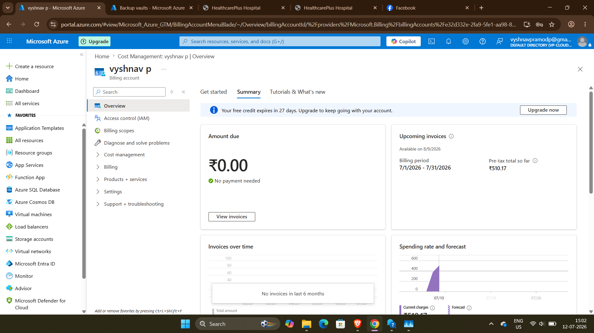

# Smart-Hospital-Infrastructure-on-Microsoft-Azure
# Smart Hospital Infrastructure on Microsoft Azure

## Project Overview

This project demonstrates the deployment and management of a Smart Hospital Infrastructure using Microsoft Azure. The solution includes networking, virtual machines, storage, security, monitoring, backup, and DNS management.

---

## Resource Group

Created Resource Group **RG-HealthcarePlus** in Central India.

---

## Virtual Network and Subnets

.png)
.png)
.png)

Configured:
- VNet-Healthcare
- default subnet
- appSubnet
- managementSubnet
- AzureBastionSubnet

---

## Users and RBAC

.png)

Created:
- doctors
- frontoffice
- management

Assigned users and roles.

---

## Network Security Group

.png)

Configured inbound rules:
- HTTP (80)
- HTTPS (443)
- RDP (3389)
- SSH (22)

---

## Windows Server IIS Website

.png)

Hosted HealthcarePlus Hospital website using IIS.

---

## Ubuntu Linux Nginx Portal

.png)

Hosted internal hospital portal using Nginx.

---

## Azure Storage Account

.png)

Created:
- documents
- reports
- logs
- images

containers for hospital data.

---

## Azure File Share

.png)

Created:
- hospitalshare
- patientrecords

---

## Azure Key Vault

.png)

Stored:
- DbPassword
- StorageKey

---

## Azure DNS

.png)

Configured:
- vp-cloudelab.xyz
- www record
- portal record

---

## Azure Monitor and Log Analytics

.png)

Configured:
- Log Analytics Workspace
- Monitoring
- Alerts

---

## Recovery Services Vault and Backup

.png)

Configured VM backup and recovery.

---

## Cost Management

Configured Azure Budget and cost monitoring.

---

## Conclusion

Successfully deployed and managed a Smart Hospital Infrastructure on Microsoft Azure using:

- Azure Virtual Network
- Windows Server IIS
- Ubuntu Nginx
- Azure Storage
- Azure File Share
- Azure Key Vault
- Azure DNS
- Azure Monitor
- Recovery Services Vault
- Cost Management

This project demonstrates Azure administration, security, monitoring, backup, and web hosting capabilities.
