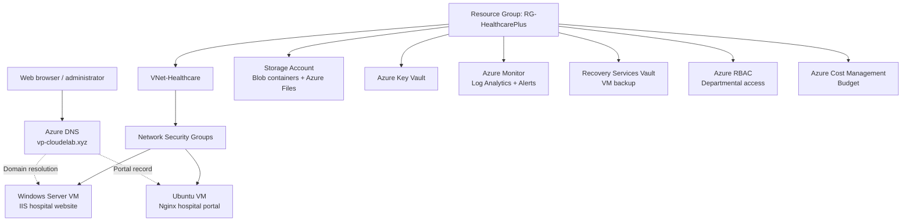

# 🏥 Smart Hospital Infrastructure on Microsoft Azure

> **Hands-on Azure infrastructure project:** designing and administering a simulated hospital cloud environment with Windows and Linux web hosting, networking, access control, storage, DNS, monitoring, and backup.

    

## 📚 Contents
- [Project overview](#-project-overview)
- [Goals and technologies](#-goals-and-technologies)
- [Architecture](#-architecture)
- [Infrastructure walkthrough](#-infrastructure-walkthrough)
- [VM configuration and deployment commands](#-vm-configuration-and-deployment-commands)
- [Security considerations](#-security-considerations)
- [Verification checklist](#-verification-checklist)
- [Skills demonstrated](#-skills-demonstrated)

## 📌 Project overview

This project documents the configuration of a **Smart Hospital Infrastructure** lab on Microsoft Azure. It brings together infrastructure services that a hospital-style environment may require: separate web hosting platforms, network segmentation, identity and role management, data storage, secrets management, domain resolution, operational visibility, and recovery planning.

**Scope:** This is an educational infrastructure demonstration, not a claim of a production-ready or healthcare-compliant system. No real patient information should be used in the lab.

| Item | Configuration documented |
|---|---|
| Azure region | Central India |
| Resource group | `RG-HealthcarePlus` |
| Virtual network | `VNet-Healthcare` |
| Subnets | `default`, `appSubnet`, `managementSubnet`, `AzureBastionSubnet` |
| Windows website | HealthcarePlus Hospital website hosted with IIS |
| Linux website | Internal hospital portal hosted with Nginx |
| DNS zone | `vp-cloudelab.xyz` |

## 🎯 Goals and technologies

- Organize cloud resources in an Azure resource group.
- Create a virtual network and subnets for different infrastructure functions.
- Set up role-based access for hospital departments.
- Configure network security rules for web and administrative traffic.
- Host a website on **Windows Server + IIS** and a portal on **Ubuntu + Nginx**.
- Use Azure Storage and Azure Files for different storage requirements.
- Store sensitive application configuration in Azure Key Vault.
- Configure domain records through Azure DNS.
- Set up monitoring, alerts, backup, and budget visibility.

**Azure services:** Resource Groups, Virtual Network, Network Security Groups, Virtual Machines, Azure RBAC, Storage Accounts, Azure Files, Key Vault, Azure DNS, Azure Monitor, Log Analytics, Recovery Services Vault, and Cost Management.

## 🧭 Architecture

The diagram below is a **conceptual overview** of the documented components. It does not assert specific routing, private endpoints, or subnet placement that have not been independently verified.

## 🛠 Infrastructure walkthrough

### 1. Resource group — organizing the deployment

**What it does:** An Azure resource group provides a logical container for related cloud resources and makes management, access control, and cost analysis easier.

**Implementation:** Created `RG-HealthcarePlus` in **Central India** as the main organizational boundary for the lab.

### 2. Virtual network and subnets — network segmentation

**What it does:** An Azure Virtual Network (VNet) provides private network connectivity for Azure resources. Subnets divide its address space into smaller network segments.

**Implementation:** Configured `VNet-Healthcare` with `default`, `appSubnet`, `managementSubnet`, and `AzureBastionSubnet`.

**Why it matters:** Separate subnets make it easier to design distinct policies for applications, management access, and other infrastructure roles. The `AzureBastionSubnet` name is reserved for Azure Bastion; its presence alone does not establish that Bastion was deployed.

.png)
.png)
.png)

### 3. Users and RBAC — departmental access

**What it does:** Azure role-based access control (RBAC) grants permissions at a defined scope, helping implement least-privilege access.

**Implementation:** Documented departmental identities/groups named `doctors`, `frontoffice`, and `management`, with user and role assignments.

**Why it matters:** Hospital departments should receive only the Azure management permissions necessary for their responsibilities. Azure RBAC is distinct from authorization inside a hospital application.

.png)
.png)
.png)

### 4. Network Security Groups — controlling traffic

**What it does:** NSGs filter inbound and outbound network traffic using prioritized security rules.

**Implementation:** Documented inbound rules for HTTP **80**, HTTPS **443**, RDP **3389**, and SSH **22**.

| Port | Protocol/use | Recommended exposure |
|---|---|---|
| 80 | HTTP web traffic | Public only when required; redirect to HTTPS where appropriate |
| 443 | HTTPS web traffic | Public for intended websites |
| 3389 | Windows RDP administration | Restrict to trusted sources or use private access |
| 22 | Linux SSH administration | Restrict to trusted sources or use private access |

**Security note:** Listing these ports does not mean they should all be publicly accessible. Validate rule sources, priorities, subnet/NIC associations, and actual reachability.

.png)
.png)
.png)

### 5. Windows Server + IIS — hospital website

**What it does:** Internet Information Services (IIS) is Microsoft's web server platform for hosting sites and applications on Windows Server.

**Implementation:** Hosted the **HealthcarePlus Hospital** website on a Windows Server VM using IIS.

**Deployment workflow:** Provision a Windows VM → configure allowed management/web access → install IIS → place website files in the configured site directory → configure site bindings → verify the website in a browser. These are explanatory steps; the screenshots document the actual lab work.

.png)
.png)
.png)
.png)
.png)
.png)
.png)

### 6. Ubuntu + Nginx — internal portal

**What it does:** Nginx is a lightweight web server commonly used on Linux systems.

**Implementation:** Hosted an **internal hospital portal** using Nginx on an Ubuntu VM.

**Deployment workflow:** Provision Ubuntu → configure SSH access → install and start Nginx → deploy portal content → configure server blocks and access rules → test the portal. If a portal is intended to be internal-only, verify that it is not reachable from the public internet.

.png)
.png)
.png)
.png)
.png)

### 7. Azure Storage — object storage

**What it does:** Azure Blob Storage stores unstructured objects such as images, documents, reports, and log files.

**Implementation:** Created containers named `documents`, `reports`, `logs`, and `images`.

**Why it matters:** Separate containers support organization and differentiated access policies. Real hospital records would require additional privacy, encryption, retention, and access controls.

.png)
.png)
.png)
.png)
.png)
.png)

### 8. Azure Files — shared file storage

**What it does:** Azure Files provides managed file shares that can be accessed using supported file-sharing protocols.

**Implementation:** Created shares named `hospitalshare` and `patientrecords`.

**Why it matters:** File shares provide a familiar shared-folder model. A share name does not establish that it contains real patient data.

.png)
.png)
.png)
.png)

### 9. Azure Key Vault — secrets management

**What it does:** Key Vault helps manage secrets, keys, and certificates without embedding sensitive values directly in application code.

**Implementation:** Documented secrets named `DbPassword` and `StorageKey`.

**Why it matters:** Applications should retrieve secrets using controlled identities and permissions; secret values should never be published in screenshots or a public repository.

.png)
.png)
.png)
.png)
.png)
.png)

### 10. Azure DNS — domain configuration

**What it does:** Azure DNS hosts DNS records so domain names can resolve to the intended endpoints.

**Implementation:** Documented the zone `vp-cloudelab.xyz`, including `www` and `portal` records, and changing authoritative nameservers at the domain provider.

**Why it matters:** DNS records allow visitors to use memorable hostnames instead of raw IP addresses. DNS alone does not configure HTTPS certificates or access restrictions.

.png)
.png)
.png)
.png)
.png)
.png)

### 11. Azure Monitor and Log Analytics — observability

**What it does:** Azure Monitor collects and analyzes telemetry. Log Analytics enables queries over collected logs; alerts help surface conditions needing attention.

**Implementation:** Documented a Log Analytics workspace, monitoring configuration, and alerts.

**Why it matters:** Monitoring helps investigate VM availability, performance, and operational issues. Alert effectiveness depends on configured signals, thresholds, and notification destinations.

.png)
.png)
.png)
.png)
.png)
.png)
.png)

### 12. Recovery Services Vault — backup and recovery

**What it does:** A Recovery Services vault manages supported backup and recovery workloads, including Azure VM backup.

**Implementation:** Documented VM backup and recovery configuration.

**Why it matters:** Backups help recover from accidental deletion, corruption, or infrastructure failures. A completed backup is not the same as a tested restore; recovery tests should be performed separately.

.png)
.png)
.png)
.png)
.png)
.png)
.png)
.png)
.png)

### 13. Cost Management — budget visibility

**What it does:** Azure Cost Management helps track cloud spending and set budget thresholds.

**Implementation:** Documented an Azure budget and cost monitoring.

**Why it matters:** VMs, storage, backups, and networking services may incur ongoing charges even in a learning environment. Budgets provide alerts but do not automatically stop resource spending.

**Domain research screenshots**

.png)
.png)

## 💻 VM configuration and deployment commands

For a detailed walkthrough of **Windows Server IIS installation, Ubuntu Nginx installation, service verification, and example website deployment commands**, see the [VM Configuration & Website Deployment Guide](docs/vm-configuration.md).

**Evidence transparency:** The walkthrough references screenshots from a previous Azure lab, not the current hospital deployment. Example file-copy and web server configuration commands are clearly marked as illustrative rather than verified historical commands.

## 🔐 Security considerations

This lab includes several security building blocks, but production healthcare environments require further design and validation:

- Use **least-privilege RBAC** and review role assignments regularly.
- Avoid exposing **SSH/RDP** to unrestricted public IP ranges.
- Enforce **HTTPS** with valid certificates for any public-facing website.
- Use private connectivity and appropriate network rules for internal services.
- Never commit passwords, keys, connection strings, or real patient information.
- Review backup retention and periodically **test restores**.
- Evaluate applicable privacy, data residency, logging, and regulatory requirements before handling healthcare data.

## ✅ Verification checklist

Use this checklist to record what was actually tested. The existence of a configuration screenshot does not automatically prove end-to-end functionality.

- [ ] Website loads through its intended hostname
- [ ] Internal portal is accessible only to authorized users/networks
- [ ] DNS records resolve to the expected endpoints
- [ ] HTTP/HTTPS traffic behaves as intended
- [ ] SSH/RDP are restricted to approved management paths
- [ ] Departmental RBAC permissions have been tested
- [ ] Storage containers and file shares enforce intended access
- [ ] Key Vault secrets are accessible only to authorized identities
- [ ] Monitor alerts have been triggered and verified
- [ ] VM backup completes successfully
- [ ] A restore test has been performed
- [ ] Azure budget notifications are configured and tested

## 🎓 Skills demonstrated

**Cloud administration:** Resource groups, Azure VMs, regional resource deployment, and cost awareness.

**Networking:** VNet design, subnets, NSG traffic rules, and DNS configuration.

**System administration:** Windows Server with IIS and Ubuntu Linux with Nginx.

**Security:** Azure RBAC, access restrictions, and Key Vault secret management.

**Operations:** Storage administration, monitoring, alerts, and backup planning.

## 📝 Conclusion

This project brings together core Microsoft Azure infrastructure services in a single, documented hospital-themed lab. It demonstrates practical exposure to deploying and administering Windows and Linux web servers alongside networking, identity, storage, security, DNS, monitoring, and recovery services.

**Future improvements:** Add verified network/IP diagrams, repeatable deployment scripts, a tested disaster recovery runbook, and documented end-to-end validation results.

---

*Project documentation reflects the configurations described in the repository. Screenshots and settings should be reviewed before reusing this architecture in a real environment.*
